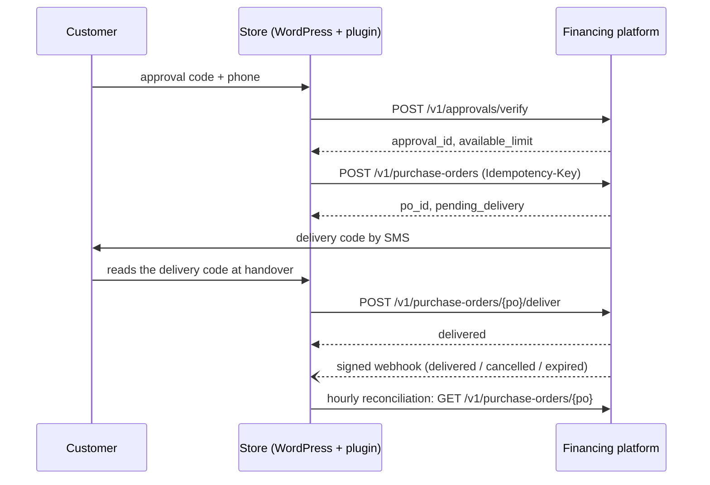

# wp-financing-integration-lab

A WordPress plugin that connects store orders to a consumer-financing platform's REST API, and the test bench that proves it handles the parts that go wrong in production: lost responses, retries, double clicks, duplicate or out-of-order webhooks, forged webhooks, and webhooks that never arrive.

The financing platform here is a mock ([`tests/e2e/mock_platform.py`](tests/e2e/mock_platform.py)) shaped like a typical consumer-financing API: approval codes with limits and expiry, purchase orders, delivery codes sent to the customer, and cancellations. A real platform's field names and endpoints will differ; those differences stay inside one class ([`Api/Client.php`](plugin/financing-bridge/src/Api/Client.php)), and the rest of the plugin does not change.

## The flow



Order states: `new → approved → pending_delivery → delivered`. An order can move to `cancelled` before delivery, and to `expired` when the platform reports it. `needs_review` is where an order goes when the store and the platform disagree; a person resolves it, not the code.

## What it guarantees, and the test that proves each one

All in [`tests/e2e/test_flows.py`](tests/e2e/test_flows.py), run against real WordPress and MySQL in CI.

| Guarantee | How | Test |
|---|---|---|
| A lost response never creates a second purchase order | Every write sends an `Idempotency-Key` derived from the order and the action. A retry, minutes later or from another request, sends the same key and gets the same PO back. | `test_lost_response_on_purchase_order_creates_exactly_one_po`, `test_retry_after_failed_call_reuses_the_key_and_the_po` |
| Outages are retried, and only safe requests are retried | Exponential backoff with jitter, honouring `Retry-After`. Only reads and keyed writes are retried; business errors such as `limit_exceeded` are never retried. | `test_platform_outage_retries_then_succeeds`, unit tests |
| A failed call changes nothing | The platform is called first; local state changes only after the platform confirms. | `test_long_outage_leaves_the_order_unchanged` |
| Forged, altered or replayed webhooks are rejected | HMAC-SHA256 over `timestamp.body`, compared in constant time, with a 5-minute window. Event IDs are stored, so a replay inside the window is a no-op. | `test_unsigned_tampered_or_stale_webhooks_are_rejected`, `test_duplicate_webhook_is_acknowledged_once` |
| A late, contradicting event never overwrites a final state | A "cancelled" event for an order the store already delivered flags it for review; the delivered state stays. | `test_late_contradicting_webhook_flags_review_and_never_overwrites` |
| A webhook that never arrives is caught anyway | Hourly WP-Cron reconciliation (also `wp financing reconcile`) asks the platform for the status of every open order. | `test_missed_webhook_is_caught_by_reconciliation` |
| A webhook and a staff action at the same time can't clobber each other | Optimistic locking: every state change is `UPDATE … WHERE state = ? AND version = ?`; the loser re-reads and decides again. | `OrderRepository::transition` |
| Brute-forcing the delivery code is stopped | Three wrong codes lock the order and flag it for review. | `test_three_wrong_delivery_codes_lock_the_order_for_review` |
| No approval code, delivery code or phone number is stored or logged | Not stored in any table. The audit log masks them by key and masks digit runs that look like phones or national IDs (`*********78`). | `test_no_codes_or_phone_numbers_are_stored_or_logged` |
| Amounts can't drift | Integer minor units (piastres) end to end. Line items must add up to the order total, and the approved limit must cover it, checked before the purchase order is created. | `test_items_must_add_up_to_the_order_amount`, `test_limit_below_order_amount_is_refused` |
| The staff API isn't public | `finb_manage` capability; the webhook is the only unauthenticated route, and it is authenticated by signature. | `test_staff_api_requires_authentication`, `test_staff_api_full_flow_with_application_password` |

## Using it

Configuration lives in `wp-config.php`, never in the database:

```php
define('FINB_API_BASE', 'https://uat.financing.example/api');
define('FINB_API_KEY', '...');
define('FINB_WEBHOOK_SECRET', '...'); // 32+ characters, shared with the platform
```

Webhook URL to give the platform: `https://your-site/wp-json/financing/v1/webhook`.

**Staff REST API** (for the checkout or back office), requiring the `finb_manage` capability:

```
POST /wp-json/financing/v1/orders/{ref}/verify          {amount, currency, approval_code, customer_phone}
POST /wp-json/financing/v1/orders/{ref}/purchase-order  {items: [{sku, name, quantity, unit_price}]}
POST /wp-json/financing/v1/orders/{ref}/deliver         {delivery_code}
POST /wp-json/financing/v1/orders/{ref}/cancel          {reason}
GET  /wp-json/financing/v1/orders/{ref}
```

**WP-CLI**, for support and UAT:

```
wp financing verify ORD-1001 --amount=1500000 --code=482913 --phone=01012345678
wp financing po ORD-1001 --items='[{"sku":"TV-55","name":"TV","quantity":1,"unit_price":1500000}]'
wp financing deliver ORD-1001 --code=7731
wp financing cancel ORD-1001 --reason="customer request"
wp financing reconcile
wp financing show ORD-1001        # state + full redacted audit trail
```

**Tools → Financing orders** lists orders, with the ones needing review first.

## Layout

```
plugin/financing-bridge/
  financing-bridge.php     bootstrap, hooks, cron, CLI registration
  src/Api/                 HTTP client, retry policy, typed errors (WordPress HTTP API transport)
  src/Domain/              order states and allowed transitions
  src/Security/            webhook signatures, redaction
  src/Store/               tables, optimistic-locking repository, audit log
  src/Service/             the four business actions, webhook handling, reconciliation
  src/Http/                webhook endpoint, staff REST API
  src/Cli/, src/Admin/     WP-CLI commands, admin page
tests/unit/                PHPUnit: state machine, signatures, redaction, client retries and errors
tests/e2e/                 pytest: real WordPress + MySQL against the mock platform
```

## Run it

```bash
composer install && vendor/bin/phpunit && vendor/bin/phpstan analyse   # unit tests + PHPStan level 8
./scripts/setup-wp.sh                                                    # throwaway WordPress with the plugin active
pip install -r requirements-dev.txt && pytest -q tests/e2e               # 24 end-to-end tests
```

CI runs the unit tests on PHP 8.1 and 8.3, and the end-to-end tests against WordPress 6.6 and the latest release on MySQL 8.

## Not covered

- **Returns and refunds after delivery.** Every platform handles these differently, so they are left for the real API documentation.
- **WooCommerce.** The plugin keeps its own order table keyed by the store's order reference, so it works with WooCommerce or a custom order system. Mapping WooCommerce order statuses is a small adapter on top.
- **A real financing provider.** The mock follows common patterns; the real platform's UAT environment is where the field names, error codes and webhook format get confirmed.
